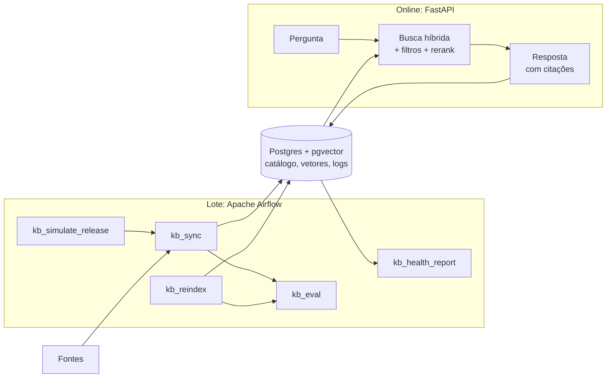
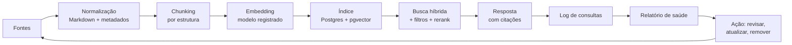

# Base de Conhecimento Gerenciável para RAG

> **Status:** fases 1 a 5 implementadas e verificadas numa instalação do zero (2026-10-25). A fase 6 está proposta no roadmap. Este documento é o planejamento original, atualizado com as decisões tomadas durante a implementação.

## 1. Problema

Um RAG costuma funcionar bem na demonstração e piorar em produção. Os documentos mudam, são removidos, duplicados ou vencem. Depois de alguns meses, ninguém sabe dizer:

- qual versão de cada documento está indexada;
- qual modelo de embedding gerou cada vetor;
- o que acontece se a estratégia de chunking ou o modelo mudarem;
- se a base ainda responde bem às perguntas que os usuários fazem.

A base de conhecimento vira uma caixa-preta difícil de manter e arriscada de alterar.

## 2. Objetivo

Construir do zero uma estrutura completa para **criar e manter** a base de conhecimento de um agente. Ela cobre desde a entrada de um documento até o monitoramento da saúde da base meses depois.

Cada atualização da base dispara uma cadeia de processos: normalização, chunking, embedding, indexação, avaliação e relatórios. Por isso, a manutenção é tratada como um **pipeline de dados orquestrado**, construído do zero e com um propósito claro em cada etapa.

O visitante deve conseguir:

1. subir o ambiente com um comando;
2. ingerir um corpus de demonstração;
3. simular a evolução da base ao longo do tempo (documentos alterados, removidos, vencidos, troca de modelo);
4. acompanhar cada execução do pipeline na interface do orquestrador;
5. ver, a cada etapa, como a estrutura reage, com métricas e relatórios.

## 3. O que o visitante aprende

- Como modelar fontes, documentos, versões e chunks para que a base seja rastreável.
- Como gerar IDs determinísticos para que reprocessar um arquivo nunca duplique conteúdo.
- Como fazer atualização incremental: só reprocessar o que mudou.
- Como remover conteúdo sem perder histórico (tombstone) e como consultar a base "como ela era" numa data.
- Como trocar o modelo de embedding ou a estratégia de chunking sem tirar a busca do ar (reindexação blue/green).
- Como montar uma busca híbrida (palavra-chave + vetor) com filtros de metadados e controle de acesso.
- Como medir a qualidade da base e detectar regressões a cada mudança.
- Como monitorar a saúde da base: conteúdo vencido, duplicado, conflitante, e perguntas sem boa resposta.
- Como orquestrar ingestão, manutenção e avaliação como pipelines de dados com Apache Airflow.
- Como registrar decisões de arquitetura (ADRs) com contexto, alternativas e justificativa.

## 4. Escopo

### Dentro
- Fontes locais: Markdown, PDF, TXT, HTML e e-mail (.eml), apenas com texto e tabelas.
- Catálogo e vetores em Postgres + pgvector.
- Controle de acesso por metadados: a busca filtra o conteúdo pelo perfil e pelo escopo do usuário.
- Ingestão inicial, sincronização incremental e reindexação completa.
- Orquestração dos processos em lote com Apache Airflow.
- Busca híbrida, filtros e reranking opcional.
- Geração de resposta com citação do documento e da versão.
- Relatório de saúde e avaliação com golden set.
- CLI, API e painel de administração.
- Registro das decisões de arquitetura (ADRs).

### Fora (por enquanto)
- Multi-tenant e autenticação.
- Conectores SaaS (Google Drive, Confluence, Notion).
- Escala de milhões de documentos.
- Imagens e conteúdo multimodal.

## 5. Arquitetura: lote e online

O sistema tem dois caminhos que compartilham o mesmo banco:

- **Lote (Airflow):** ingestão, sincronização, reindexação, avaliação e relatórios. Roda por agenda, por evento de dados ou manualmente, e pode levar minutos.
- **Online (API):** a pergunta do usuário. Precisa responder em segundos e **não passa pelo Airflow**.



**Regra principal:** toda a lógica fica no pacote `kb`. As DAGs do Airflow, a CLI e a API só chamam as mesmas funções. Isso mantém o código testável sem o Airflow e evita duplicar regras de negócio.

## 6. Ciclo de vida da base



## 7. Pipelines orquestrados (DAGs)

| DAG | Gatilho | Etapas | Recursos do Airflow demonstrados |
|---|---|---|---|
| `kb_sync` | Agenda (diária) ou manual | Planejar (classificar cada documento) → uma tarefa por documento pendente (chunking, embedding, nova versão) → tombstones → publicar o índice atualizado | Agendamento, **dynamic task mapping** (uma tarefa por documento alterado), retry por tarefa, emissão de asset |
| `kb_eval` | Atualização do índice (asset `kb_indice`) | Listar pipelines → uma tarefa por pipeline: rodar o golden set da release atual, registrar em `eval_runs` e comparar com a execução anterior → falhar se houver vazamento, documento proibido ou regressão | **Agendamento por dados (assets)**, dynamic task mapping, falha como bloqueio de qualidade |
| `kb_health_report` | Agenda (semanal) ou manual | Contexto → 8 verificações em paralelo (os conflitos esperam as duplicatas) → consolidar, registrar e gravar o Markdown | Agendamento, tarefas paralelas, parâmetros (`data`, `usar_juiz`) |
| `kb_reindex` | Manual, com parâmetros (modelo, chunking) | Construir o índice novo → avaliar → promover ou descartar → manter rollback | **Parâmetros de execução**, **branching** |
| `kb_simulate_release` | Manual, com o parâmetro `release` | Copiar a release para a pasta de fontes → disparar `kb_sync` | Parâmetros, disparo de outra DAG |

**Princípios das DAGs:**
- **Finas:** cada tarefa chama uma função do pacote `kb`, sem regra de negócio dentro da DAG.
- **Idempotentes:** reexecutar uma tarefa produz o mesmo resultado. Os IDs determinísticos e o hash de conteúdo garantem isso.
- **Granulares:** a falha de um documento não interrompe os outros e pode ser repetida isoladamente.

A justificativa completa da escolha está em [ADR-001](docs/decisoes/ADR-001-orquestracao-airflow.md).

## 8. Modelo de dados (rascunho)

| Tabela | Papel | Campos principais |
|---|---|---|
| `sources` | Origem do conteúdo | `id`, `tipo`, `caminho`, `responsavel`, `frequencia_revisao` |
| `documents` | Identidade estável do documento | `id`, `source_id`, `titulo`, `tipo_documento`, `status`, `aposentado_em`, metadados de acesso |
| `document_versions` | Cada versão importada | `id`, `document_id`, `versao`, `content_hash`, `valid_from`, `valid_to`, `review_by` |
| `chunks` | Trechos indexáveis, reaproveitados entre versões | `id` determinístico, `document_id`, `caminho_secao`, `conteudo`, `texto_embedding`, `content_hash`, `tsv` (full-text) |
| `version_chunks` | Quais chunks compõem cada versão, por configuração de índice | `index_config_id`, `version_id`, `chunk_id`, `ordem` |
| `emb_<index_config>` | Vetores: uma tabela por configuração de índice | `chunk_id`, `embedding` (na dimensão do modelo) |
| `embedding_models` | Modelos usados | `id`, `nome`, `dimensao`, `criado_em` |
| `index_configs` | Configurações de índice (uma ativa) | `id`, `chunker`, `chunker_params`, `embedding_model_id`, `tabela_embeddings`, `ativo` |
| `query_logs` | Consultas reais | `origem`, `pergunta`, `perfil`, `pipeline`, `as_of`, `latencia_ms`, `melhor_score`, `resultados`, `criado_em` |
| `health_reports` | Histórico dos relatórios de saúde | `data_referencia`, `index_config_id`, `resumo`, `secoes` |
| `eval_runs` | Histórico de avaliações | `index_config_id`, `metricas`, `criado_em` |

**ID determinístico do chunk:** `hash(document_id + caminho_da_secao + content_hash)`.

**Vigência:** `valid_from` e `valid_to` são inclusivos. A busca usa uma data de referência: `--as-of`, ou o relógio simulado `KB_DATA_SIMULADA`, que permite demonstrar viradas de mês sem depender da data real.

O histórico de execuções do pipeline fica no banco de metadados do próprio Airflow, um banco separado dentro do mesmo servidor Postgres.

## 9. Estratégias de atualização

| Evento | O que acontece |
|---|---|
| Documento novo | Cria `document`, versão 1, chunks e embeddings |
| Documento alterado | Diff por seção via hash. Chunks inalterados são reaproveitados, os alterados ganham nova versão e a anterior recebe `valid_to` |
| Seção removida | Chunk marcado como `retired` (tombstone): sai da busca e fica no histórico |
| Documento removido da fonte | Documento marcado como `retired` |
| Reimportação idêntica | Nada acontece (hash igual) |
| Troca de modelo de embedding | Nova `index_config`, reindexação em segundo plano (`kb_reindex`), troca do índice ativo ao final e rollback possível |
| Mudança na estratégia de chunking | Mesmo fluxo da troca de modelo, com a configuração versionada |
| Documento vencido (`review_by`) | Aparece no relatório de saúde, com a opção de excluí-lo da busca até ser revisado |

**Consulta no tempo:** `as_of=AAAA-MM-DD` responde com o conteúdo vigente naquela data, o que serve para auditoria.

## 10. Busca

- **Híbrida:** full-text do Postgres (`tsvector`, dicionário português, consulta OU entre os lexemas da pergunta) + similaridade vetorial (pgvector), combinados por Reciprocal Rank Fusion.
- **Filtros na recuperação:** vigência na data de referência (`as_of`) e acesso do perfil, aplicados igualmente aos dois recuperadores, antes de qualquer trecho chegar ao LLM.
- **Reranking** opcional com um cross-encoder servido pelo Text Embeddings Inference.
- **Pipelines de consulta versionadas** em `configs/pipelines/*.yaml` (`vetorial`, `hibrida`, `hibrida-rerank`). Trocar de pipeline não exige reindexar.
- **Citações:** toda resposta indica documento, seção e versão de origem.

### Controle de acesso

A política fica em `data/perfis.yaml`: um campo ordinal (`visibilidade`: publico < vendedor < gerente) e restrições por campo (`marca`, `loja`). Um documento é visível ao perfil se o seu nível não for superior ao do perfil e se, para cada campo restrito, o documento tiver o campo vazio (vale para todos) ou um valor permitido. A mesma regra existe como filtro SQL (usado na busca) e em Python (usado pela avaliação para detectar vazamentos), e um teste garante que as duas dão o mesmo resultado.

## 11. Manutenção e saúde da base

A DAG `kb_health_report` (semanal, verificações em paralelo) ou o comando `kb health` geram um relatório com três severidades: **erro** (a base está errada), **alerta** (precisa de revisão humana) e **info** (acompanhamento). Os limiares ficam em `configs/saude.yaml`, e cada relatório é registrado em `health_reports` e gravado em `reports/saude/<data>.md`.

| Seção | O que verifica |
|---|---|
| Revisão | Versões vigentes com revisão vencida (alerta) ou nos próximos 15 dias (info) |
| Vigência encerrada | Documentos ainda na fonte cuja vigência terminou, que podem ser arquivados |
| Quase-duplicatas | Documentos vigentes diferentes com trechos de similaridade ≥ 0,97 |
| Possíveis conflitos | Regras contraditórias entre documentos vigentes: candidatos por heurística, confirmados por um juiz LLM com verificação dupla ([ADR-005](docs/decisoes/ADR-005-deteccao-de-conflitos.md)) |
| Consistência | Trechos vigentes sem embedding (erro) e registros órfãos |
| Fragmentos | Pedaços pequenos que sobraram da divisão de uma seção grande |
| Lacunas | Perguntas reais (log de consultas) cujo melhor trecho teve score baixo: conteúdo a criar ou falha de busca |
| Avaliação | Última avaliação de cada pipeline: vazamentos (erro) e regressões (alerta) |

### Log de consultas

Toda busca feita por usuários (CLI, painel) é registrada em `query_logs` com o perfil, a pipeline, a data de referência, a latência e os trechos devolvidos. As buscas da avaliação não entram no log, para não misturar perguntas de teste com perguntas reais. O comando `kb simular-consultas` roda perguntas de demonstração (`data/consultas_demo.yaml`), algumas sem resposta na base.

### Painel de administração

Streamlit (`admin/app.py`, profile `admin` do compose): visão geral, documentos com diff entre versões, busca com perfil, pipeline e data, relatórios de saúde, evolução das avaliações (um gráfico por métrica) e consultas com as lacunas.

### Relógio da demonstração

`KB_DATA_SIMULADA=release` faz a "data de hoje" de consultas e relatórios acompanhar a data de referência da release para a qual a fonte aponta. Depois de cada `kb_simulate_release`, o sistema "vive" naquela data.

## 12. Avaliação

- **Golden set:** perguntas, com as seções esperadas e uma resposta de referência.
- **Métricas de recuperação (implementadas):** recall@1, recall@3, recall@k, MRR, vazamentos de acesso (conferidos em Python, independentemente do filtro SQL), documentos proibidos (como vigência encerrada) e latência.
- **Métricas de resposta (pendentes, dependem do modelo de geração):** fidelidade da resposta (juiz LLM com rubrica) e taxa de respostas com informação desatualizada, usando a `resposta_referencia` do golden set.
- **Regressão:** a DAG `kb_eval` roda após cada atualização do índice, compara com a execução anterior e falha se alguma métrica piorar.

## 13. Stack e ambiente

| Camada | Tecnologia |
|---|---|
| Banco (catálogo e vetores) | Postgres + pgvector |
| Modelos (embedding e geração) | Ollama: `bge-m3` (embedding) e `qwen3:4b` (juiz de conflitos e, depois, respostas) |
| Reranking | Text Embeddings Inference (CPU) com cross-encoder multilíngue |
| Orquestração de pipelines | Apache Airflow (LocalExecutor) |
| API | FastAPI (planejada) |
| Painel de administração | Streamlit + Altair |
| CLI | Typer |
| Ambiente | Docker Compose com profiles `cpu`, `gpu-nvidia` e `gpu-amd` |

**Serviços do compose:**
- `postgres` (com os bancos `kb` e `airflow`);
- `ollama` e `ollama-init` (baixa os modelos);
- `reranker` (Text Embeddings Inference);
- `airflow-init`, `airflow-apiserver`, `airflow-scheduler`, `airflow-dag-processor`;
- `admin` (profile `admin`, painel Streamlit); a `api` ainda não foi implementada.

**Requisitos:** cerca de 8 GB de RAM livres para a stack completa. O Airflow não roda nativamente no Windows, então nesse sistema a execução é via Docker (ou WSL).

## 14. Dados de demonstração

Corpus fictício com o **mínimo de documentos suficiente** para demonstrar cada etapa, e três releases. Os cenários candidatos ficam em arquivos `CENARIO_*.md`:

- [CENARIO_RH_TI.md](CENARIO_RH_TI.md): assistente interno de RH e TI de uma empresa fictícia.
- [CENARIO_CONCESSIONARIA.md](CENARIO_CONCESSIONARIA.md): assistente de vendas de um grupo de concessionárias fictício.

Estrutura geral das releases:

| Release | Simula | O que a demonstração mostra |
|---|---|---|
| Mês 1 | Criação da base | Ingestão inicial, primeira avaliação |
| Mês 2 | Documentos alterados e removidos | Sincronização incremental, tombstones, consulta `as_of` |
| Mês 3 | Documento vencido, troca do modelo de embedding | Relatório de saúde, reindexação blue/green, comparação de métricas |

As releases são aplicadas pela DAG `kb_simulate_release`. O script `simulate_timeline` faz o mesmo sem o Airflow, chamando as funções do pacote `kb` em sequência.

## 15. Interfaces

**CLI**

| Comando | Função |
|---|---|
| `kb ingest <pasta>` | Aponta a fonte para uma pasta e sincroniza |
| `kb sync` | Sincroniza com a pasta já registrada para a fonte |
| `kb versoes <documento>` | Histórico de versões e vigência |
| `kb query "<pergunta>" [--as-of] [--perfil] [--pipeline]` | Consulta a base com o escopo de acesso de um perfil |
| `kb perfis` | Perfis de acesso disponíveis |
| `kb reindex [--modelo] [--chunker] [-p chave=valor] [--promover]` | Reindexação blue/green com avaliação e decisão |
| `kb indices` / `kb ativar <índice>` | Configurações de índice; troca manual e rollback |
| `kb health` | Relatório de saúde |
| `kb eval [--pipeline] [--release] [--detalhes] [--estrito]` | Avaliação com o golden set, comparada com a execução anterior |

**API:** `POST /sources`, `POST /sync`, `GET /documents`, `GET /documents/{id}/versions`, `GET /documents/{id}/diff`, `POST /query`, `GET /health-report`, `POST /eval`.

**Painel:** fontes, documentos e versões (com diff), relatório de saúde, histórico de avaliações, log de consultas.

**Airflow:** grafo de cada pipeline, histórico de execuções, logs por tarefa e disparo manual com parâmetros.

## 16. Estrutura de pastas

```
Base de Conhecimento RAG/
├── PROPOSTA.md, CENARIO_*.md, README.md
├── docker-compose.yml          # profiles cpu / gpu-nvidia / gpu-amd / airflow / admin
├── .env.example
├── pyproject.toml
├── src/kb/
│   ├── sources/                # registro e leitura de fontes
│   ├── parsing/                # normalização e seções do Markdown
│   ├── chunking/               # hierárquico, fixo, recursivo, semântico; IDs determinísticos
│   ├── embedding/              # clientes e prefixos por modelo
│   ├── store/                  # catálogo, vetores, logs e migrações SQL
│   ├── retrieval/              # busca híbrida, RRF, rerank, pipelines
│   ├── access/                 # política de acesso por metadados
│   ├── evaluation/             # golden set, métricas e regressões
│   ├── maintenance/            # sync, blue/green, relatório de saúde, conflitos
│   └── cli/                    # comandos kb
├── configs/                    # pipelines de consulta e limiares de saúde
├── dags/                       # DAGs do Airflow (só chamam o pacote kb)
├── docker/                     # imagens do Airflow e do painel
├── admin/                      # painel Streamlit
├── data/
│   ├── facts.yaml              # fatos canônicos e registro das fontes
│   ├── templates/              # texto dos documentos e do golden set
│   ├── corpus/release_1..3/    # corpus gerado por release
│   ├── golden_set/             # golden set gerado por release
│   ├── perfis.yaml             # política de acesso e perfis
│   └── consultas_demo.yaml     # perguntas de demonstração para o log
├── scripts/                    # gerador do corpus, experimento de chunking, checagem das DAGs
├── tests/
├── docs/
│   ├── decisoes/               # ADRs
│   └── experimentos/           # resultados dos experimentos
└── .github/workflows/          # CI
```

## 17. Roadmap

| Fase | Entrega | Pipeline |
|---|---|---|
| 1. MVP | Ingestão de Markdown, chunking por estrutura, pgvector, `kb query`, tudo testado pela CLI | — |
| 2. Versionamento e orquestração | Versões, hash, sincronização incremental, tombstone, `as_of`, corpus com três releases; Airflow no compose | `kb_sync`, `kb_simulate_release` |
| 3. Qualidade | Busca híbrida, rerank, controle de acesso, golden set | `kb_eval` disparada pela atualização do índice |
| 4. Manutenção | Relatório de saúde, log de consultas, painel de administração | `kb_health_report` |
| 5. Evolução | Reindexação blue/green, CI, ADRs, documentação final e README com resultados | `kb_reindex` com branching |
| 6. Respostas (proposta) | API (FastAPI) para o agente, geração de respostas com citação e precedência entre escopos, fluxo "não encontrei" pelo score do rerank, avaliação de fidelidade com juiz LLM usando a `resposta_referencia` do golden set, ajuste do peso da busca textual no RRF | `kb_eval` com métricas de resposta |

**Andamento:**
- Fase 1 concluída em 2026-10-24: 18 documentos e 88 chunks na release 1, com testes unitários e de integração.
- Fase 2 concluída em 2026-10-24: sincronização incremental (nova versão, metadados, tombstone, reativação), releases 2 e 3, Airflow 3.3 com `kb_sync` e `kb_simulate_release`. A linha do tempo completa roda pela CLI e pelo Airflow.
- Fase 3 concluída em 2026-10-24: busca híbrida (pgvector + full-text, RRF), rerank (TEI), controle de acesso por perfil, pipelines versionadas, golden set por release, `kb eval` com histórico em `eval_runs` e a DAG `kb_eval` disparada pelo asset do índice. Na release 3, `hibrida-rerank` teve recall@1 de 0,938 e MRR de 0,969, sem vazamentos.
- Fase 4 concluída em 2026-10-25: relatório de saúde com 8 verificações (incluindo conflitos com juiz `qwen3:4b` e verificação dupla), log de consultas com lacunas, painel Streamlit, DAG `kb_health_report` e relógio da release. Em fevereiro, o relatório encontra os 2 conflitos reais do corpus sem falsos positivos.
- Fase 5 concluída em 2026-10-25: reindexação blue/green (`kb reindex`, `kb indices`, `kb ativar`, DAG `kb_reindex` com bifurcação), experimento de chunking com 7 estratégias, troca para chunking hierárquico com fusão de fragmentos e para o modelo `nomic-embed-text-v2-moe` (ambas pelo blue/green), CI no GitHub Actions e documentação final.
- API, geração de respostas e avaliação de fidelidade ficam para a fase 6.

## 18. Critérios de pronto

- [x] `docker compose --profile cpu up` + `kb demo` deixam a demonstração pronta numa instalação limpa (verificado a partir dos arquivos do repositório, com banco vazio: cerca de 3 min em CPU).
- [x] As cinco DAGs aparecem no Airflow e rodam sem erro (verificado na instalação limpa).
- [x] `kb_simulate_release` reproduz as releases e dispara a sincronização, a avaliação e o relatório.
- [x] Testes do pacote `kb` rodam na CI sem LLM real e sem Airflow (workflow simulado localmente com sucesso; a primeira execução no GitHub acontece no primeiro push).
- [x] O README apresenta o problema, a arquitetura, os resultados, telas e como rodar.
- [x] Cada decisão de arquitetura relevante tem um ADR (6 ADRs).

## 19. Decisões

### Registradas
- [x] Orquestração com Apache Airflow: [ADR-001](docs/decisoes/ADR-001-orquestracao-airflow.md).
- [x] Postgres + pgvector como banco de catálogo e vetores: [ADR-002](docs/decisoes/ADR-002-postgres-pgvector.md).
- [x] Reranker no Text Embeddings Inference com `mmarco-mMiniLMv2-L12-H384-v1`: [ADR-004](docs/decisoes/ADR-004-reranker.md).
- [x] Detecção de conflitos com heurística + juiz LLM: [ADR-005](docs/decisoes/ADR-005-deteccao-de-conflitos.md).
- [x] Modelo de geração: `qwen3:4b` via Ollama (juiz de conflitos e, depois, respostas).
- [x] Chunking hierárquico com fusão de fragmentos: [ADR-003](docs/decisoes/ADR-003-estrategia-de-chunking.md).
- [x] Modelo de embedding `nomic-embed-text-v2-moe`, promovido por blue/green: [ADR-006](docs/decisoes/ADR-006-modelo-de-embedding.md).
- [x] Cenário: concessionária ([CENARIO_CONCESSIONARIA.md](CENARIO_CONCESSIONARIA.md)). O de RH e TI fica registrado como alternativa.
- [x] Embedding: bge-m3 na configuração inicial (aceita até 8.192 tokens e dispensa prefixos); nomic-embed-text-v2-moe na troca do mês 3 (dimensão diferente, o que exercita a reindexação blue/green).
- [x] Formatos: Markdown, PDF, TXT, HTML e e-mail, sem imagens.
- [x] Controle de acesso por metadados: incluído no escopo.
- [x] Tamanho do corpus: o mínimo suficiente para a demonstração.


### Em aberto
- [ ] Streamlit ou outra opção para o painel.
- [ ] Nome final do repositório.
