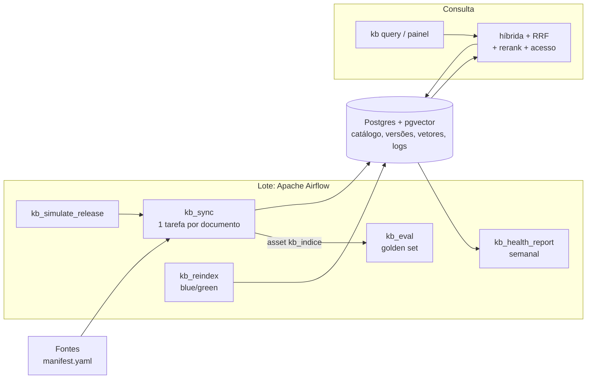
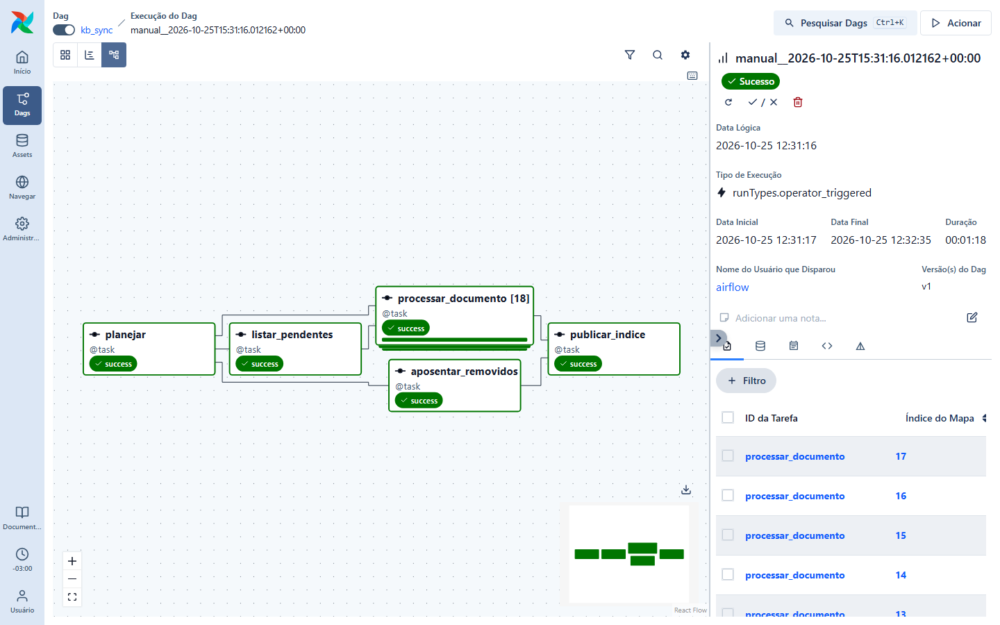
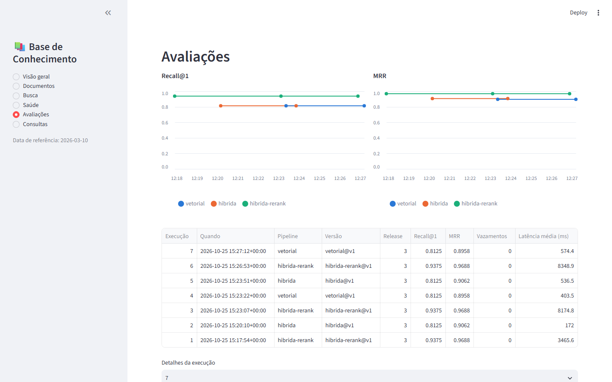
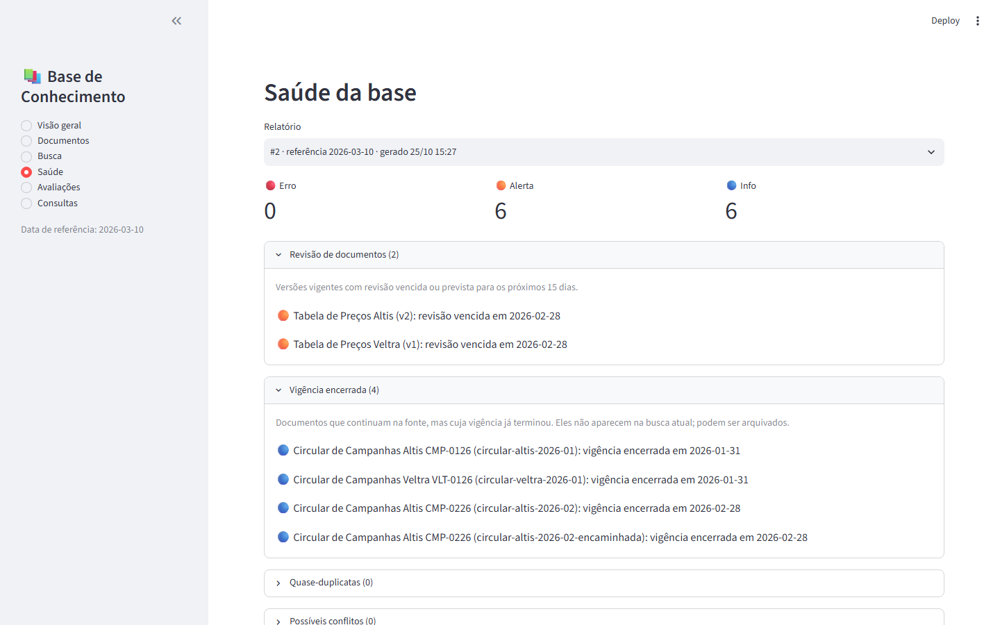

# Base de Conhecimento Gerenciável para RAG

[](https://github.com/gilmarbljr/rag-base-de-conhecimento/actions/workflows/ci.yml)
[](LICENSE)

Este projeto mostra como manter **confiável ao longo do tempo** a base de conhecimento que um agente de IA consulta. Num assistente de vendas de concessionárias (cenário fictício), preços são reajustados, campanhas vencem e regras mudam todo mês. A base gerenciável garante que o agente responda com a regra vigente, que cada perfil veja só o que pode ver e que a qualidade das respostas seja medida a cada atualização.

## 🎯 O Problema vs. A Solução

**O Problema (RAG sem gestão):**
Colocar um RAG para funcionar uma vez é fácil. O difícil é o que vem depois: os documentos mudam, mas a base continua guardando o texto antigo, a cópia nova e a circular que já venceu, tudo misturado. O agente responde com a regra do mês passado, oferece uma campanha encerrada, mostra ao cliente uma informação interna ou recebe duas regras que se contradizem sem saber qual vale. E ninguém percebe, porque não há nada medindo a base depois que ela entra no ar.

**A Solução (base de conhecimento gerenciável):**
A manutenção vira parte do sistema. Cada documento tem versões com início e fim de vigência, e a busca considera só o que vale na data da pergunta. O acesso é filtrado por perfil antes de qualquer trecho chegar ao LLM. Um pipeline no Apache Airflow sincroniza os documentos, mede a qualidade a cada atualização e gera um relatório de saúde semanal, que aponta regras contraditórias, documentos vencidos e perguntas que a base não sabe responder. Trocas de modelo ou de estratégia de chunking são testadas num índice paralelo e só entram se não piorarem a busca.

| Situação | RAG sem gestão | Base gerenciável |
|---|---|---|
| Cliente fechou o pedido em 28/01; a tabela foi reajustada em 01/02 | ❌ Responde com o preço novo, ou mistura os dois | ✅ Responde com o preço vigente na data do pedido |
| Cliente pergunta em fevereiro pela campanha de taxa zero de janeiro | ❌ Continua oferecendo a campanha encerrada | ✅ A circular sai da busca sozinha quando a vigência termina |
| Cliente pergunta qual o desconto máximo que o vendedor pode dar | ❌ Recupera a tabela de alçadas, exclusiva de gerentes | ✅ Nenhum trecho restrito chega ao LLM: zero vazamentos nos testes |
| "O bônus de troca do Trilha acumula com o desconto PCD?" (fevereiro) | ❌ Traz primeiro a regra geral do manual ("acumula") | ✅ Traz primeiro a circular vigente ("não acumula") e aponta o conflito entre os documentos no relatório de saúde |
| Clientes perguntam várias vezes algo que a base não tem | ❌ O agente responde com o trecho mais parecido, e ninguém fica sabendo | ✅ A pergunta vira uma lacuna de conteúdo no relatório |
| Trocar o modelo de embedding | ❌ Reindexa tudo e torce para não piorar | ✅ Índice paralelo, avaliado contra o atual, troca só se não piorar e rollback em um comando |

Todos os dados são fictícios: o cenário completo está em [CENARIO_CONCESSIONARIA.md](CENARIO_CONCESSIONARIA.md).

## 🏗️ Arquitetura



O planejamento completo está em [PROPOSTA.md](PROPOSTA.md), as decisões de arquitetura em [docs/decisoes/](docs/decisoes/) e os experimentos em [docs/experimentos/](docs/experimentos/).

### Componentes

- **Registro de fontes:** uma pasta de documentos descrita por um `manifest.yaml`, com vigência, acesso e data de revisão de cada documento.
- **Chunking hierárquico:** um chunk por seção, com IDs determinísticos e tabelas preservadas.
- **Sincronização incremental:** detecta documentos novos, alterados, só com metadados alterados, removidos (tombstone) e reativados. Numa nova versão, os chunks que não mudaram são reaproveitados com o mesmo embedding.
- **Histórico e consulta no tempo:** cada versão tem a sua vigência. A busca considera só o conteúdo vigente na data de referência.
- **Busca híbrida com rerank:** vetorial (pgvector) + full-text em português (Postgres), fundidas por Reciprocal Rank Fusion, e reordenadas por um cross-encoder. As pipelines de consulta são arquivos YAML versionados.
- **Controle de acesso:** cada perfil vê só o conteúdo do seu nível, da sua marca e da sua loja. O filtro é aplicado na busca, antes de qualquer trecho chegar ao LLM.
- **Avaliação contínua:** um golden set por release mede recall, MRR, vazamentos de acesso e conteúdo proibido. Cada execução é registrada e comparada com a anterior.
- **Relatório de saúde:** revisões vencidas, vigências encerradas, quase-duplicatas, conflitos entre documentos (heurística + juiz LLM), consistência do índice, trechos pequenos demais, lacunas de conteúdo e regressões da avaliação.
- **Log de consultas:** toda busca de usuário é registrada. Perguntas sem boa resposta viram lacunas de conteúdo no relatório.
- **Painel de administração (Streamlit):** documentos e diff entre versões, busca com perfil e data, relatórios de saúde, evolução das avaliações e consultas.
- **Reindexação blue/green:** troca de modelo de embedding ou de estratégia de chunking sem tirar a busca do ar, com avaliação do candidato contra o índice ativo antes da troca e rollback em um comando.
- **Orquestração com Airflow:** `kb_sync` (uma tarefa por documento alterado), `kb_eval` (disparada pela atualização do índice, falha em caso de vazamento ou regressão), `kb_health_report` (semanal, verificações em paralelo), `kb_reindex` (blue/green com bifurcação promover/manter) e `kb_simulate_release` (linha do tempo de demonstração).
- **Integração contínua:** lint, testes unitários e de integração com Postgres, e carga das DAGs na imagem do Airflow.

## Resultados

### Busca

Índice ativo (chunking hierárquico com fusão de fragmentos, `nomic-embed-text-v2-moe`), golden set das três releases (60 perguntas; recall e MRR sobre as 48 com trecho esperado), k = 5, em CPU:

| Pipeline | Recall@1 | MRR | Vazamentos | Latência média |
|---|---|---|---|---|
| `vetorial` | 0,875 | 0,929 | 0 | 164 ms |
| `hibrida` | 0,812 | 0,901 | 0 | 144 ms |
| `hibrida-rerank` (produção) | **0,917** | **0,958** | 0 | 3,4 s |

O rerank resolve os casos em que um trecho relacionado vinha antes do certo. Um exemplo: em fevereiro, "O bônus de troca do Trilha acumula com o desconto PCD?" trazia primeiro a regra geral ("sim"). Com o rerank, vem primeiro a circular de fevereiro, que é a regra vigente ("não"). Nenhuma pipeline vazou conteúdo para perfis sem acesso.

### Experimentos e decisões

| Pergunta | Resultado | Registro |
|---|---|---|
| Qual reranker usar em CPU? | `mmarco-mMiniLMv2` (118M): mesma qualidade do `bge-reranker-v2-m3`, 14 vezes mais rápido | [ADR-004](docs/decisoes/ADR-004-reranker.md) |
| Qual estratégia de chunking? | Sem rerank, o tamanho fixo (500) é o melhor. Com rerank, o hierárquico empata (diferença de 1 pergunta em 48) e exige 3 vezes menos re-embeddings por release. Mantido o hierárquico, com fusão de fragmentos | [ADR-003](docs/decisoes/ADR-003-estrategia-de-chunking.md), [experimento](docs/experimentos/chunking.md) |
| Trocar o modelo de embedding? | `nomic-embed-text-v2-moe` ganhou 8 pontos de recall@1 na busca vetorial sobre o `bge-m3` e empatou com rerank. Promovido pelo blue/green | [ADR-006](docs/decisoes/ADR-006-modelo-de-embedding.md) |
| Como detectar conflitos entre documentos? | Heurística + juiz `qwen3:4b` com verificação dupla: 2 de 2 conflitos reais, nenhum falso positivo | [ADR-005](docs/decisoes/ADR-005-deteccao-de-conflitos.md) |

Nem toda hipótese se confirmou: agrupar seções pequenas para ganhar o tamanho dos trechos de janela piorou a busca, e a busca híbrida ficou abaixo da só vetorial. Os dois achados estão registrados como próximos passos nos ADRs.

## Telas

**Airflow:** sincronização da release 1, com uma tarefa por documento (dynamic task mapping, 18 tarefas).



**Painel de administração:** evolução das avaliações por pipeline e relatório de saúde.





## Relatório de saúde

`kb health` (ou a DAG semanal `kb_health_report`) aponta o que precisa de atenção na base. Exemplos reais do corpus de demonstração:

| Data | Achado |
|---|---|
| 15/02/2026 | **Conflito:** a circular CMP-0226 diz que o bônus de troca do Trilha não acumula com PCD, enquanto o manual PCD e a matriz dizem que acumula. Confirmado pelo juiz `qwen3:4b`, sem falsos positivos entre 15 candidatos ([ADR-005](docs/decisoes/ADR-005-deteccao-de-conflitos.md)) |
| 15/02/2026 | **Quase-duplicata:** a circular de fevereiro e a cópia encaminhada por outra área |
| 10/03/2026 | **Revisão vencida:** as tabelas de preços Altis e Veltra deveriam ter sido revisadas até 28/02 |
| 10/03/2026 | **Lacunas:** "O Vento Híbrido vem com carregador para casa?" (3 vezes), "Qual o valor do seguro do Nexa?" e "Vocês vendem motos?": conteúdo que a base não tem |
| 10/03/2026 | **Fragmento:** a ata da reunião deixou um trecho de 55 caracteres ao ser dividida |

## Requisitos

- Docker (com Docker Compose). A stack completa com Airflow pede cerca de 8 GB de RAM livres.
- [uv](https://docs.astral.sh/uv/) para o ambiente Python.

## Como rodar

```bash
# 1. Configuração
cp .env.example .env

# 2. Banco, Ollama e reranker (CPU). Os modelos são baixados no primeiro start.
docker compose --profile cpu up -d

# 3. Ambiente Python e demonstração completa (tabelas, 3 releases, consultas, avaliação e saúde)
uv sync
uv run kb demo            # cerca de 3 min em CPU; --completo inclui todas as pipelines e o juiz LLM
```

Na primeira subida, o serviço `ollama-init` baixa os modelos (cerca de 5 GB). Acompanhe com `docker compose logs -f ollama-init-cpu` e rode o `kb demo` quando ele terminar.

Os passos que o `kb demo` executa também podem ser feitos um a um:

### Opção A: pela CLI

```bash
uv run kb init                             # tabelas e índice inicial
uv run kb ingest data/corpus/release_1     # janeiro: criação da base
uv run kb ingest data/corpus/release_2     # fevereiro: reajuste, nova exigência PCD, circular nova
uv run kb ingest data/corpus/release_3     # março: programa encerrado, cópia de circular

uv run kb query "O bônus de troca do Trilha acumula com o desconto PCD?" --as-of 2026-02-15 --perfil cliente-recife
uv run kb query "Qual o desconto máximo que o vendedor pode dar?" --perfil cliente-recife   # nada de alçadas
uv run kb eval --detalhes

uv run kb simular-consultas data/consultas_demo.yaml   # perguntas de usuários, algumas sem resposta
uv run kb health                                       # relatório de saúde (reports/saude/)
uv run kb health --data 2026-02-15                     # fevereiro: o conflito circular x manual PCD
```

### Painel de administração

```bash
uv sync --extra admin
uv run streamlit run admin/app.py          # ou: docker compose --profile admin up -d
```

Abra http://localhost:8501.

### Opção B: pelo Airflow

```bash
docker compose --profile cpu --profile airflow up -d
```

Abra http://localhost:8080 e dispare **kb_simulate_release** com `release` = 1, 2 e 3, em sequência. Cada release dispara a **kb_sync**, e o índice atualizado dispara a **kb_eval**.

Para GPU, troque o profile `cpu` por `gpu-nvidia` ou `gpu-amd`.

## Comandos

| Comando | Função |
|---|---|
| `kb init` | Aplica as migrações e registra a configuração de índice (chunker + modelo) |
| `kb ingest <pasta> [--data-efetiva]` | Aponta a fonte para uma pasta e sincroniza |
| `kb sync [--fonte] [--data-efetiva]` | Sincroniza com a pasta já registrada para a fonte |
| `kb query "<pergunta>" [-k N] [--as-of] [--perfil] [--pipeline]` | Busca os trechos mais relevantes |
| `kb perfis` | Perfis de acesso disponíveis |
| `kb eval [--pipeline] [--release] [--detalhes] [--estrito]` | Avalia as pipelines com o golden set e compara com a execução anterior |
| `kb health [--data] [--sem-juiz] [--nao-salvar]` | Relatório de saúde, registrado e gravado em `reports/saude/` |
| `kb consultas [--limite]` | Últimas consultas registradas |
| `kb simular-consultas <arquivo>` | Roda perguntas de demonstração como se fossem de usuários |
| `kb indices` | Configurações de índice (chunker + modelo), cobertura e última avaliação |
| `kb reindex [--modelo] [--chunker] [-p chave=valor] [--promover auto\|sim\|nao]` | Reindexação blue/green: constrói, avalia contra o ativo e decide a troca |
| `kb ativar <índice>` | Troca manual do índice ativo (rollback) |
| `kb versoes <documento>` | Histórico de versões e vigência de um documento |
| `kb chunks <documento> [--conteudo] [--as-of]` | Mostra como um documento foi dividido |
| `kb stats` | Resumo do catálogo e do índice ativo |

## Reindexação blue/green

Trocar o modelo de embedding ou a estratégia de chunking exige reindexar a base. A troca é feita sem tirar a busca do ar:

1. um índice candidato é construído ao lado do ativo, com **todas as versões** de todos os documentos (a consulta no tempo continua funcionando);
2. os dois índices são avaliados com o golden set de todas as releases, com a mesma pipeline;
3. o candidato só vira o ativo se não piorar recall@1 nem MRR e não vazar conteúdo;
4. a troca é uma transação. O índice anterior fica intacto, e o rollback é `kb ativar <índice anterior>`.

```bash
uv run kb reindex --modelo nomic-embed-text-v2-moe                 # troca de modelo
uv run kb reindex -p agrupar_ate=600                                # mesmo chunker, outros parâmetros
uv run kb reindex --chunker fixo -p tamanho=500 -p sobreposicao=75 --promover nao
uv run kb indices
```

No Airflow, a DAG **kb_reindex** faz o mesmo, com uma tarefa por documento na construção e uma bifurcação (`promover` ou `manter`) no final.

## Controle de acesso

A política está em [data/perfis.yaml](data/perfis.yaml):

| Perfil | Nível | Restrições |
|---|---|---|
| `cliente-recife` | público | marca Altis, loja Recife |
| `vendedor-sao-paulo` | vendedor | marca Veltra, loja São Paulo |
| `gerente-campinas` | gerente | loja Campinas |

Um documento é visível se o seu nível não for superior ao do perfil e se, para cada campo restrito, o documento tiver o campo vazio (vale para todos) ou um valor permitido. Sem `--perfil`, a consulta não aplica filtro (uso administrativo).

## Linha do tempo de demonstração

| Release | Data efetiva | O que muda | O que a sincronização faz |
|---|---|---|---|
| 1 | 15/01/2026 | Criação da base | 18 documentos novos |
| 2 | 10/02/2026 | Reajuste da tabela Altis; laudo com no máximo 12 meses no PCD Veltra; circular de fevereiro | 2 novas versões (com chunks reaproveitados) e 1 documento novo. As circulares de janeiro saem da busca pela vigência, sem reprocessamento |
| 3 | 10/03/2026 | Programa Rota Limpa encerrado; cópia encaminhada da circular; troca do modelo de embedding | 1 tombstone e 1 documento novo (quase-duplicata para o relatório de saúde). A troca de modelo é feita por `kb reindex --modelo nomic-embed-text-v2-moe` |

O relógio simulado `KB_DATA_SIMULADA` define a "data de hoje" das consultas e relatórios. Com `release` (padrão), ele acompanha a data de referência da release para a qual a fonte aponta. Use `--as-of` (consultas) ou `--data` (relatório) para qualquer outra data.

## Dados

O corpus em `data/corpus/` e o golden set em `data/golden_set/` são gerados a partir de `data/facts.yaml` e dos templates em `data/templates/`. Veja [data/README.md](data/README.md).

## Testes

```bash
uv run pytest
```

Os testes de integração rodam contra um Postgres real, com embeddings e reranker falsos. Eles percorrem a linha do tempo, conferem que o filtro de acesso em SQL equivale à regra em Python e rodam a avaliação. Só são executados quando `KB_TEST_DATABASE_URL` aponta para um Postgres com pgvector, e criam e removem um banco temporário:

```bash
KB_TEST_DATABASE_URL=postgresql://kb:kb@localhost:5432/kb uv run pytest
```

Para conferir as DAGs dentro do container: `docker compose exec airflow-scheduler airflow dags list-import-errors`.

## Integração contínua

O workflow [.github/workflows/ci.yml](.github/workflows/ci.yml) roda em cada push e pull request:

- **Lint e testes**, com um Postgres + pgvector como serviço. Incluem os testes de integração, que confirmam que o corpus e o golden set versionados estão iguais ao que o gerador produz.
- **DAGs do Airflow:** constrói a imagem do Airflow com o pacote `kb` e carrega as DAGs com `scripts/check_dags.py`, falhando se alguma tiver erro de importação.
